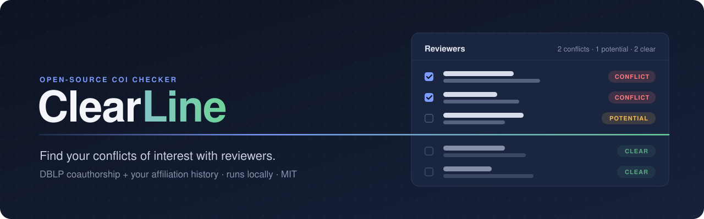

<p align="center">
  
</p>

# ClearLine

Find your conflicts of interest with a venue's reviewers, without scrolling
through hundreds of names.

Submitting to SIGMOD, VLDB or any venue that uses CMT, EasyChair or OpenReview?
Copy the reviewer list, paste it into ClearLine, and get three groups:

- **Conflicts**: coauthored with you within the venue's window, at your
  institution recently (by name or email domain), or listed in your profile
  (advisor, students, family).
- **Potential conflicts**: older coauthorship, a past institution, a related
  institution (another lab, site or campus), or a common name where some
  namesake is your coauthor.
- **Clear**: everyone else.

Every result shows its evidence (the shared papers, the matching institution or
domain), so you can check it before ticking the box.

Everything runs on your machine. ClearLine has no server, account or telemetry,
and the only network access is downloading the public DBLP dump.

## Install

ClearLine needs Python 3.12+ and no other packages. With [uv](https://docs.astral.sh/uv/):

```sh
uv tool install git+https://github.com/<you>/clearline   # or: uv tool install .
clearline setup     # downloads DBLP (~1.1 GB) and imports it, about 15 minutes, once
clearline serve     # opens http://127.0.0.1:8765
```

`clearline refresh` re-downloads the latest DBLP dump later on; the download is
checked against DBLP's published MD5 before it replaces the old one. After
upgrading ClearLine, it may ask you to run `clearline setup` again to rebuild the
database from the dump you already have. Data lives in
`~/.clearline` (set `CLEARLINE_HOME` to move it). The imported database takes
about 4 GB; pass `--delete-dump` to `setup` to remove the 1.1 GB download afterwards.

## Use it

1. **Make your profile** (the *Profiles* tab, or `clearline profile new`):
   your DBLP identity, where you have worked or studied with email domains and
   months, and people you always conflict with. It is saved as a small TOML
   file you can edit:

   ```toml
   name = "Jane Doe"
   dblp = "123/4567"

   [[affiliations]]
   institution = "University of Wisconsin-Madison"
   domains = ["wisc.edu"]
   start = "2021-09"
   end = ""            # empty = current

   [[affiliations]]
   institution = "Stanford University"
   domains = ["stanford.edu"]
   start = "2016-09"
   end = "2021-06"

   [[relations]]
   name = "John Advisor"
   kind = "advisor"
   ```

2. **Add your coauthors on the paper.** Pick their profiles, or search DBLP for
   coauthors who have none.
3. **Set the venue policy:** how many years of coauthorship and shared
   institution count. The defaults (2 and 2) are common but not universal, so
   check the call for papers.
4. **Paste the reviewer list** and press *Find conflicts*. Conflicts start out
   selected. Review the potential ones, then copy the names.

From the command line:

```sh
clearline search "Jane Doe"
clearline check reviewers.txt -p jane-doe -a "Wei Wang 0002" --coauthor-years 2
pbpaste | clearline check - -p jane-doe --names-only
clearline check reviewers.txt -p jane-doe --json > coi.json
```

The reviewer list can be one name per line, `Name (Institution)`,
`Name, Institution`, `Name <email>`, `Last, First`, or rows copied from a table
with tabs between columns.

## How matching works

- **Coauthorship** comes from DBLP. DBLP already separates people who share a
  name (`Wei Wang 0001`, `Wei Wang 0002`) and merges name variants, so
  ClearLine works on DBLP persons, not raw strings. Every DBLP publication with
  authors counts, including arXiv preprints (CoRR); proceedings volumes, where
  people are editors, do not.
- **Reviewer names** are matched to DBLP persons after normalizing case,
  accents and punctuation (`Jürgen Müller` = `jurgen muller`, `Işık` = `Isik`).
- **Every namesake is checked.** DBLP has hundreds of people named Wei Wang.
  ClearLine considers all of them, plus people who differ only by a middle name
  (`Michael Franklin` and `Michael J. Franklin`). The reviewer's institution
  picks the most likely one; if any *other* namesake is your coauthor, that is
  reported as a *potential* conflict with the evidence, never silently dropped.
- **Loose name matches** are tried only when nothing else matches: nicknames
  (`Bob` = `Robert`), German spellings (`Mueller` = `Müller`), reversed order
  (`Wang Wei` = `Wei Wang`) and initials (`J. Doe`). Anything found this way is
  at most a *potential* conflict, labelled as a loose match.
- **Years:** DBLP records only the year. "Within 2 years" in November 2026
  counts all of 2024, which errs on the side of declaring.
- **Big collaborations:** papers with more than 30 authors (configurable) only
  produce potential conflicts.
- **Institutions** come from your profile's dated affiliations, compared with
  the reviewer's listed institution and email domain. The same institution
  within the window is a conflict; a related one (`MIT CSAIL` and `MIT`,
  `Microsoft Research Asia` and `Microsoft`) is potential. Names are compared
  in order, so `Washington University` is not `University of Washington`.
  Public mail domains such as gmail.com never match. If DBLP lists the
  reviewer as formerly at one of your recent institutions, that is potential.

ClearLine helps you declare conflicts; it does not replace your judgement or
the venue's rules. Unmatched names and potential conflicts still need a look.

## Development

```sh
uv sync
uv run pytest
uv run clearline serve
```

## License

MIT. DBLP data is released under CC0 by [dblp](https://dblp.org).
